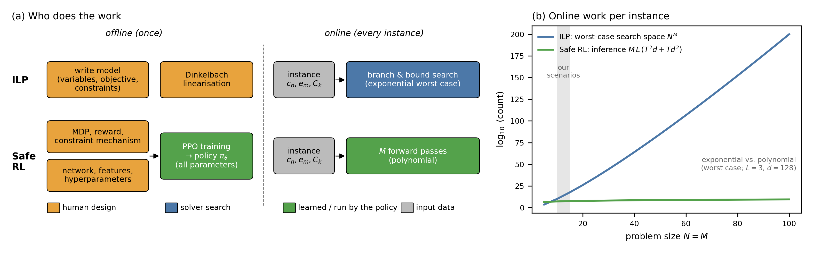
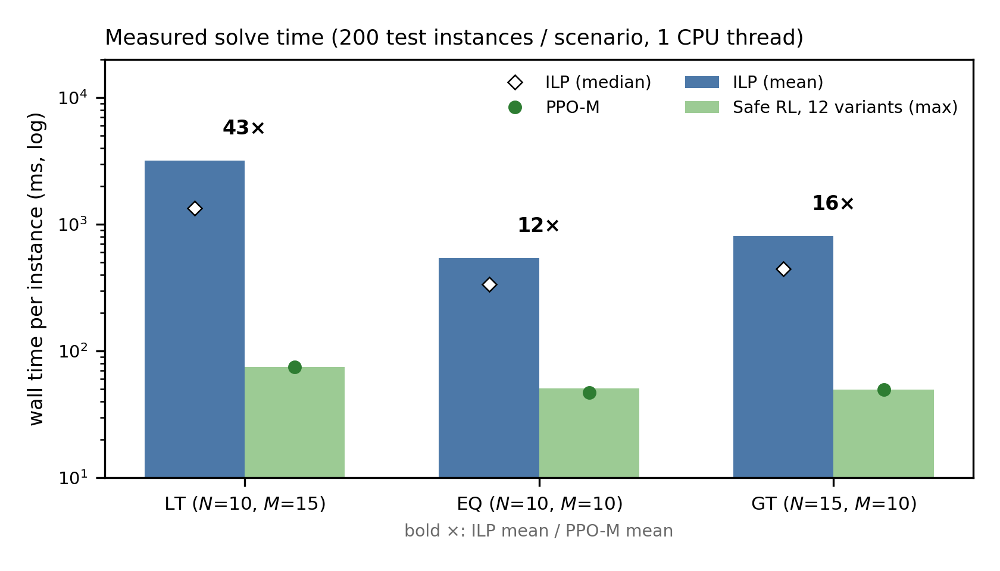
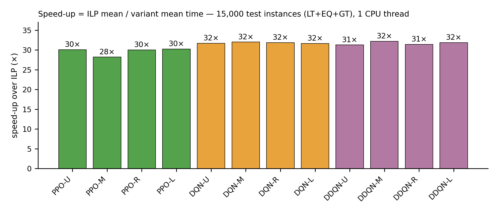
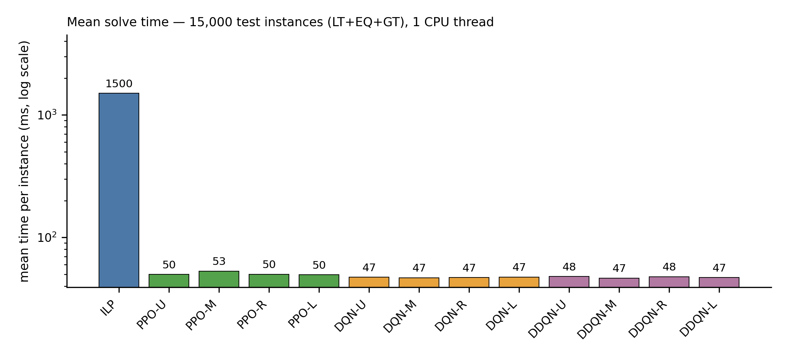

# ILP vs Safe RL: network, design effort and complexity

> Compiled from the discussion of 2026-11-07. Notation: service m (M in total), ECU n (N in total), demand e_m, capacity c_n, decisions x_mn / y_n, conflict sets C_k (K in total).

## 1. Our PPO and network

- **Algorithm**: standard libraries. PPO-M uses `sb3_contrib.MaskablePPO`, PPO-U/-R/-L use `stable_baselines3.PPO` ([train.py](../src/paper_rl/train.py)). Rollout, GAE, clipped loss, masking and the update loop are unmodified.
- **Where the network sits**: it replaces PPO's **whole policy network** (actor + critic). `GraphMaskablePolicy` ([graph_policy.py](../src/paper_rl/graph_policy.py)) subclasses `MaskableActorCriticPolicy` and overrides `forward` / `evaluate_actions` / `predict_values`. The final setting uses a **shared encoder with two heads** (`separate=True`, separate encoders, was found ineffective).
- **What the network is**: a small, self-implemented **pre-LN Transformer encoder** with relation biases on the attention logits (Graphormer style). It is not a pretrained model; parameters are randomly initialised and trained jointly with PPO. Only basic PyTorch modules are used (`nn.Linear`, `nn.LayerNorm`, `nn.GELU`, `softmax`, `nn.Parameter`); no `nn.TransformerEncoder` / `nn.MultiheadAttention` / HuggingFace.
- **Structure** ([graph_net.py](../src/paper_rl/graph_net.py)):
  - Tokens: 1 global + N ECUs + M services, linearly embedded to d dimensions plus a type embedding; **no positional encoding** → permutation-equivariant in ECUs and services.
  - Each layer: `x ← x + W_o·MHA(LN(x))`, `x ← x + FFN(LN(x))`, FFN = Linear(d→2d)–GELU–Linear(2d→d).
  - Attention:
    $$\alpha_{ij}^{(h)}=\mathrm{softmax}_j\Big(\frac{q_i^{(h)}\cdot k_j^{(h)}}{\sqrt{d_k}}+\sum_{r=1}^{4} w_{r}^{(h)}A_{r,ij}\Big)$$
    A_r are 4 relations: service–service conflict, service hosted on ECU, unplaced service conflicts with an ECU's hosted services, capacity-feasible; w is initialised to 0.
  - Hyperparameters: 3 layers, d=128, 4 heads.
  - Actor: each ECU token goes through the shared `ecu_head` to a logit, masked to give π(a|s); EXIT (Mask only) is scored from the global token. Critic: `value_head` outputs V(s).
- **Name in the paper**: relation-aware Transformer. The paper describes the **model design** (tokenisation, relation-bias formula, heads, motivation), not implementation details; cite Vaswani 2017 for the Transformer, Xiong 2020 for pre-LN, Graphormer / Shaw et al. 2018 for relation biases.

## 2. Human design effort

**Conclusion: Safe RL needs more human design than ILP.** RL's advantage is online solving complexity, not design effort.

| Design item | ILP (human) | Safe RL (human) | Safe RL (learned in training) |
|---|---|---|---|
| Modelling | variables x_mn, y_n, objective, constraints | MDP: state, action, transition, termination | — |
| Objective | AR is a ratio, linearised by Dinkelbach | per-step reward ar_pen, positive on success, negative on failure | — |
| Constraints | written directly as hard constraints | choose mechanism: mask / capacity-based best-fit repair / Lagrangian (λ_max) / none | λ of -L adjusted by dual updates |
| Features & structure | none | token features, 4 relations, network architecture | relation-bias weights, all network parameters |
| Decision rule | none, solver searches | service order (descending demand) | which ECU at each step |
| Hyperparameters | tolerance, iteration cap, mostly defaults | lr, n_steps, batch, n_epochs, clip, ent, γ, λ_GAE, tuned | — |
| Data | none | training-instance distribution and size | — |
| Effort | low: one model | high: many rounds of ablation and tuning | — |

ILP: humans describe the problem, the solver searches. RL: humans design the learning environment and network, the solving policy is learned.

**Prerequisite data**: both need c_n, e_m, C_k, M, N. RL additionally needs the service order, training instances, MDP and reward, hyperparameters. The ILP optimum is **not used for training**, only to filter feasible instances (all instances must be Optimal) and to evaluate the AR gap — state this explicitly in the paper so it is not mistaken for supervised learning.

## 3. Complexity

Let L=3, d=128, T=1+N+M.

| Item | ILP | Safe RL |
|---|---|---|
| Decision variables | MN + N binary | none, one ECU per step |
| Constraints | M + N + MN + KN | no explicit constraints; enforced or penalised by the mechanism |
| Problem complexity | strongly NP-hard | same problem, approximate solution |
| Online solving | worst case exponential × Dinkelbach iterations | polynomial: M steps, O(L(T²d+Td²)) per step |
| Offline cost | none | one-off training (millions of steps) |
| Solution quality | optimal | approximate, with AR gap |
| Constraint satisfaction | guaranteed | -M guaranteed; -R/-L/-U not, report violation rates |

## 4. Can we prove "ILP design cost grows far faster than Safe RL with complexity"?

**No, and taken literally it is probably false.** Human design effort has no mathematical definition; the ILP formulation does not change with scale (variables and constraints are generated by code). What makes design harder is **more complex problem structure**, and then RL must be redesigned too.

**What can be proven rigorously is computational cost:**

- **Proposition 1**: with no conflict sets the problem reduces to bin packing (strongly NP-hard), so the problem is strongly NP-hard; unless P=NP there is no polynomial or pseudo-polynomial exact algorithm.
- **Proposition 2**: online inference of a trained policy is $T_{\text{RL}}(M,N)=O(M\cdot L(T^2d+Td^2))$, independent of instance hardness.
- **Proposition 3** (amortisation): for I same-distribution instances, $C_{\text{ILP}}=I\cdot T_{\text{ILP}}$, $C_{\text{RL}}=C_{\text{train}}+I\cdot T_{\text{RL}}$; RL is cheaper when $I>C_{\text{train}}/(T_{\text{ILP}}-T_{\text{RL}})$, and the break-even point comes earlier as scale grows.

**Caveats**: ILP returns the optimum while RL returns an approximation without guarantees, so the comparison is not like for like; Proposition 1 is worst case and CBC is often much faster in practice, so pair it with measured solve time versus scale.

**Suggested wording**: exact solving is strongly NP-hard (Prop. 1), inference of the trained policy is polynomial (Prop. 2), and the offline training cost is amortised over many same-distribution instances (Prop. 3). **Do not write** "ILP design cost is far higher than Safe RL".

## 5. Comparison figure

Files: `paper_contents/ilp_vs_saferl/fig_ilp_vs_saferl.{pdf,eps}`, script `src/scripts/plot_ilp_vs_saferl.py`.

- **(a) Who does the work**: orange = human design, blue = solver search, green = learned / run by the policy, grey = input data; left of the dashed line is offline (once), right is online (every instance). RL needs more human design, but all of it offline; online, ILP searches every time while RL only runs forward passes.
- **(b) Online work per instance** (log10, N=M): ILP worst-case search space N^M versus policy inference M·L(T²d+Td²). Exact formulas, worst case, not measured time; ILP is not relaxed. The grey band is our scenarios (N, M ∈ [10, 15]); the curves cross at N≈8, our scenarios lie just past it where the difference is still small, so ILP is not at a disadvantage at small scale; the gap widens quickly as the size grows.
- "Network parameters vs ILP variables" is not used: the parameter count (450,227) exceeds the ILP variable count at small scale; different units, misleading.

## 6. Measured solve time

Files: `paper_contents/ilp_vs_saferl/fig_time_measured.{pdf,eps}`, script `src/scripts/plot_time_measured.py`; data from `paper_contents/v6.0.0-merge/time_bench.json` (`bench_time_v6.py`: the same 200 test instances per scenario, one CPU thread, ILP including model building and every Dinkelbach iteration, RL a full deterministic episode); no new runs.

- ILP mean 3192 / 543 / 808 ms (LT/EQ/GT), median 1337 / 338 / 444 ms; PPO-M 75 / 47 / 50 ms; all 12 variants within 40–75 ms.
- Speed-up (ILP mean / PPO-M mean): LT 43×, EQ 12×, GT 16× — the real gap is 1–2 orders of magnitude, not the 3–8 of Section 5 (b).
- Section 5 (b) only shows the growth type (exponential vs polynomial); this figure gives the real gap; use both together in the paper.
- Only three size points, not enough for a time-versus-size curve; that would need extra runs at larger N, M (queued).

## 7. Full test-set time (12 variants, main-text figures)

Files: `paper_contents/ilp_vs_saferl/fig_time_bar_{speedup,ms}.{pdf,eps,svg,png}`, script `src/scripts/plot_time_bars.py`; data `paper_contents/ilp_vs_saferl/time_full.json` (`src/scripts/bench_time_full.py`, 2026-11-07, 22.7 min): all 3×5000 instances of the fixed test set `data/testset_v6.0.4` timed one by one, one CPU thread, 24 processes in parallel; RL = seed-1 models of the summary table, every ILP Optimal.

- Pooled over the three scenarios: ILP 1500 ms; the 12 variants 46.5–53.2 ms; speed-up 28–32× (PPO-M 28×).
- Per scenario, ILP mean 3285 / 515 / 701 ms (LT/EQ/GT), PPO-M 69 / 44 / 46 ms, consistent with Section 6 (200 instances).
- Pooled speed-up = pooled ILP mean / pooled variant mean, dominated by LT's long solves; it differs from "mean of per-scenario speed-ups" (11–44×) — state which one when citing.
- Section 6 and `fig_time_full` / `fig_time_simple` are earlier versions; the main text uses only the two bar charts here (speed-up chart recommended).

## To do

- Check the final number of training instances and add it to Section 2.
- LaTeX for the three propositions and the bin-packing reduction proof.
- Curve of measured solve time versus scale.
