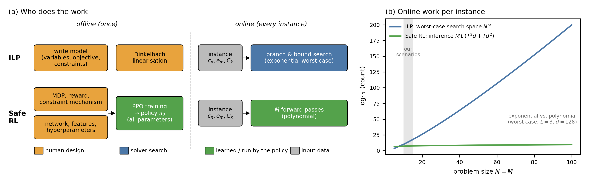
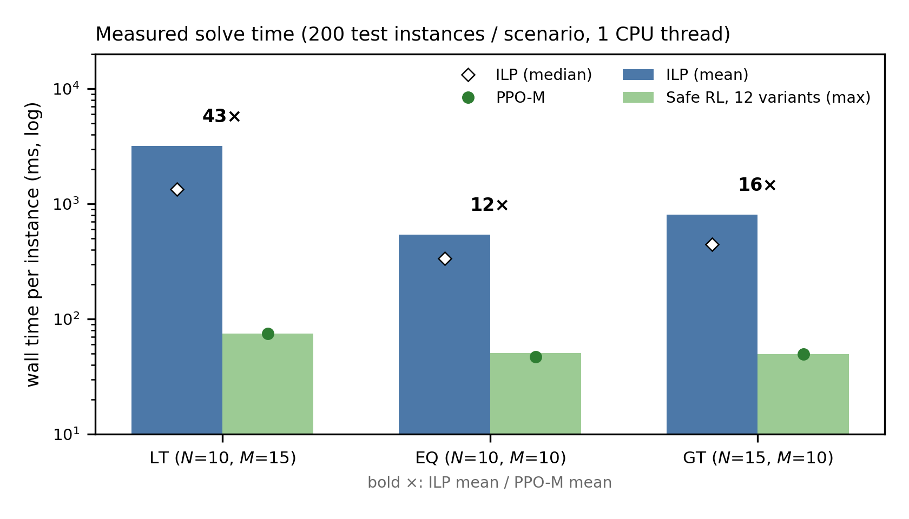
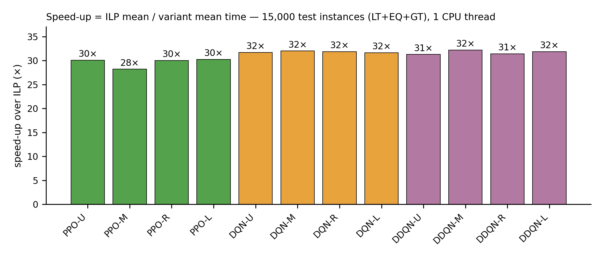
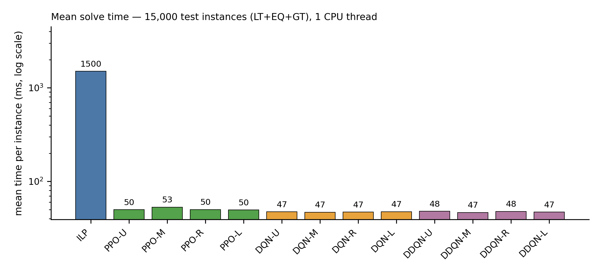

# ILP 与 Safe RL：网络结构、设计量与复杂度

> 整理自 2026-11-07 的讨论。符号：服务 m（共 M 个）、ECU n（共 N 个）、需求 e_m、容量 c_n、决策 x_mn / y_n、冲突集 C_k（共 K 个）。

## 1. 我们的 PPO 与网络

- **算法**：标准库。PPO-M 用 `sb3_contrib.MaskablePPO`，PPO-U/-R/-L 用 `stable_baselines3.PPO`（[train.py](../src/paper_rl/train.py)）。采样、GAE、clip 损失、掩码、更新循环均未修改。
- **网络位置**：替换 PPO 的**整个策略网络**（Actor + Critic）。`GraphMaskablePolicy`（[graph_policy.py](../src/paper_rl/graph_policy.py)）继承 `MaskableActorCriticPolicy`，重写 `forward` / `evaluate_actions` / `predict_values`。定稿用**共享编码器 + 两个输出头**（`separate=True` 独立编码器已验证无效）。
- **网络是什么**：自己实现的小型 **Pre-LN Transformer 编码器**，在注意力 logits 上加关系偏置（Graphormer 式），不是任何预训练模型，参数随机初始化、随 PPO 一起训练。只用 PyTorch 基础零件（`nn.Linear`、`nn.LayerNorm`、`nn.GELU`、`softmax`、`nn.Parameter`），未用 `nn.TransformerEncoder` / `nn.MultiheadAttention` / HuggingFace。
- **结构**（[graph_net.py](../src/paper_rl/graph_net.py)）：
  - token：1 个全局 + N 个 ECU + M 个服务，线性映射到 d 维并加类型嵌入；**无位置编码** → 对 ECU、服务的排列等变。
  - 每层：`x ← x + W_o·MHA(LN(x))`，`x ← x + FFN(LN(x))`，FFN = Linear(d→2d)–GELU–Linear(2d→d)。
  - 注意力：
    $$\alpha_{ij}^{(h)}=\mathrm{softmax}_j\Big(\frac{q_i^{(h)}\cdot k_j^{(h)}}{\sqrt{d_k}}+\sum_{r=1}^{4} w_{r}^{(h)}A_{r,ij}\Big)$$
    A_r 为 4 种关系：服务间冲突、服务部署在 ECU、未放服务与 ECU 上已部署服务冲突、容量可行；w 初始化为 0。
  - 超参数：3 层、d=128、4 头。
  - Actor：每个 ECU token 经共享 `ecu_head` 得到 logit，加掩码得 π(a|s)；EXIT（只有 Mask）由全局 token 打分。Critic：`value_head` 输出 V(s)。
- **论文叫法**：relation-aware Transformer。论文写**模型设计**（token 化、关系偏置公式、输出头、设计动机），不写实现细节；标准 Transformer 引 Vaswani 2017，Pre-LN 引 Xiong 2020，关系偏置引 Graphormer / Shaw et al. 2018。

## 2. 人工设计量

**结论：Safe RL 的人工设计量比 ILP 多。** RL 的优势在在线求解复杂度，不在设计量。

| 设计项 | ILP（人工） | Safe RL（人工） | Safe RL（训练中自动学到） |
|---|---|---|---|
| 问题建模 | 变量 x_mn、y_n，目标，约束 | MDP：状态、动作、转移、终止 | — |
| 目标处理 | AR 是分式，用 Dinkelbach 线性化 | 逐步奖励 ar_pen，成功正、失败负 | — |
| 约束处理 | 直接写成硬约束 | 选机制：掩码 / capacity-based best-fit 修复 / 拉格朗日（λ_max）/ 不处理 | -L 的 λ 由对偶更新调整 |
| 特征与结构 | 无 | token 特征、4 种关系、网络结构 | 关系偏置权重、全部网络参数 |
| 决策规则 | 无，求解器搜索 | 服务顺序（需求降序） | 每步选哪个 ECU |
| 超参数 | 容差、迭代上限，基本默认 | lr、n_steps、batch、n_epochs、clip、ent、γ、λ_GAE，需调参 | — |
| 数据 | 无 | 训练实例分布与规模 | — |
| 工作量 | 低：一个模型 | 高：多轮消融与调参 | — |

ILP：人描述问题，求解器负责搜索。RL：人设计学习环境和网络，求解策略由 AI 学出。

**前置数据**：两者都需要 c_n、e_m、C_k、M、N。RL 额外需要服务顺序、训练实例、MDP 与奖励、超参数。ILP 最优解**不参与训练**，只用于可行实例筛选（所有实例须为 Optimal）和 AR gap 评估——正文应明确写出，避免被误认为监督学习。

## 3. 复杂度

记 L=3，d=128，T=1+N+M。

| 项目 | ILP | Safe RL |
|---|---|---|
| 决策变量 | MN + N 个二元变量 | 无，每步输出一个 ECU |
| 约束数 | M + N + MN + KN | 无显式约束，由机制保证或惩罚 |
| 问题复杂度 | 强 NP-hard | 同一问题，给近似解 |
| 在线求解 | 最坏指数级 × Dinkelbach 迭代 | 多项式：M 步，每步 O(L(T²d+Td²)) |
| 离线成本 | 无 | 一次性训练（数百万步） |
| 解质量 | 最优 | 近似，有 AR gap |
| 约束满足 | 一定满足 | -M 保证；-R/-L/-U 不保证，报违约率 |

## 4. 能否证明“ILP 设计成本随复杂度增长远高于 Safe RL”

**不能，且按字面很可能是错的。** 人工设计量没有数学定义；ILP 的建模公式不随规模变化（变量、约束由代码生成），真正增加设计难度的是**问题结构变复杂**，而那时 RL 也要重新设计。

**可严格证明的是计算成本：**

- **命题 1**：冲突集为空时问题退化为装箱问题（强 NP-hard），故本问题强 NP-hard；除非 P=NP，不存在多项式或伪多项式精确算法。
- **命题 2**：训练好的策略在线推理为 $T_{\text{RL}}(M,N)=O(M\cdot L(T^2d+Td^2))$，与实例难度无关。
- **命题 3**（摊销）：求解 I 个同分布实例，$C_{\text{ILP}}=I\cdot T_{\text{ILP}}$，$C_{\text{RL}}=C_{\text{train}}+I\cdot T_{\text{RL}}$；当 $I>C_{\text{train}}/(T_{\text{ILP}}-T_{\text{RL}})$ 时 RL 总成本更低，规模越大盈亏点越靠前。

**限制**：ILP 给最优解、RL 给无保证的近似解，比较对象不对等；命题 1 是最坏情况，实际 CBC 常快得多，需配合实测求解时间随规模变化的曲线。

**建议表述**：精确求解是强 NP-hard 的（命题 1），训练好的策略在线推理为多项式复杂度（命题 2），离线训练成本可在大量同分布实例上摊销（命题 3）。**不要写**“ILP 的设计成本远高于 Safe RL”。

## 5. 对比图

文件：`paper_contents/ilp_vs_saferl/fig_ilp_vs_saferl.{pdf,eps}`，脚本 `src/scripts/plot_ilp_vs_saferl.py`。

- **(a) 谁在做事**：橙色=人工设计，蓝色=求解器搜索，绿色=训练学到/由策略执行，灰色=输入数据；虚线左边为离线（一次），右边为在线（每个实例）。一眼可见：RL 的人工设计更多，但都在离线；在线时 ILP 每次都要搜索，RL 只做前向计算。
- **(b) 每个实例的在线工作量**（log10，N=M）：ILP 最坏搜索空间 N^M 对比策略推理 M·L(T²d+Td²)。都是精确公式、最坏情况，不是实测时间，未放宽 ILP。灰色带为我们的场景（N,M∈[10,15]），两线在 N≈8 处相交，我们的场景刚过交点，差距还小，所以小规模下 ILP 并不吃亏；规模再大差距迅速拉开。
- 不用“网络参数量 vs ILP 变量数”：参数量（450,227）比小规模 ILP 变量还多，量纲不同，会误导。

## 6. 实测求解时间

文件：`paper_contents/ilp_vs_saferl/fig_time_measured.{pdf,eps}`，脚本 `src/scripts/plot_time_measured.py`；数据来自 `paper_contents/v6.0.0-merge/time_bench.json`（`bench_time_v6.py`：每场景同一批 200 个测试实例，单 CPU 线程，ILP 含建模与全部 Dinkelbach 迭代，RL 为完整确定性 episode），未新跑。

- ILP 均值 3192 / 543 / 808 ms（LT/EQ/GT），中位数 1337 / 338 / 444 ms；PPO-M 75 / 47 / 50 ms；12 个变体都在 40–75 ms。
- 加速比（ILP 均值 / PPO-M 均值）：LT 43×、EQ 12×、GT 16×——实际差距 1–2 个数量级，不是第 5 节右图的 3–8 个。
- 第 5 节 (b) 只说明增长方式（指数 vs 多项式），本图给出真实差距；论文中两图配合使用。
- 只有三个规模点，不足以画随规模变化的曲线；如需要，须在更大 N、M 上补测（需排队）。

## 7. 完整测试集耗时（12 个变体，主文用图）

文件：`paper_contents/ilp_vs_saferl/fig_time_bar_{speedup,ms}.{pdf,eps,svg,png}`，脚本 `src/scripts/plot_time_bars.py`；数据 `paper_contents/ilp_vs_saferl/time_full.json`（`src/scripts/bench_time_full.py`，2026-11-07，22.7 分钟）：固定测试集 `data/testset_v6.0.4` 全部 3×5000 个实例逐实例计时，CPU 单线程、24 进程并行；RL 为总表种子 1 模型，ILP 全部 Optimal。

- 三场景合并平均：ILP 1500 ms；12 个变体 46.5–53.2 ms；加速比 28–32×（PPO-M 28×）。
- 分场景 ILP 均值 3285 / 515 / 701 ms（LT/EQ/GT），PPO-M 69 / 44 / 46 ms，与第 6 节（200 实例）一致。
- 合并加速比 = 合并 ILP 均值 / 合并变体均值，被 LT 的长耗时主导；与“各场景加速比再平均”（11–44×）口径不同，引用时注明。
- 第 6 节与 `fig_time_full` / `fig_time_simple` 为早期版本，主文只用本节两张条形图（推荐加速比图）。

## 待办

- 定稿训练实例数待核对后补入第 2 节。
- 三个命题的 LaTeX 与装箱归约证明。
- 实测求解时间随规模变化的曲线。
