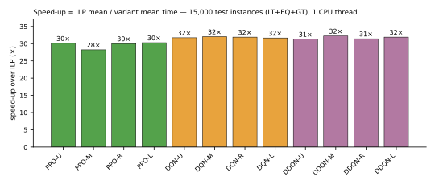
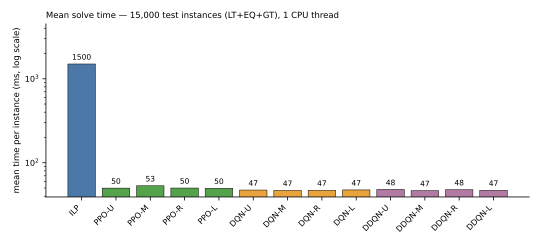

# 5.7 Computation Time

### 表 5.10  单实例耗时（ms，均值；括号内为 ILP 中位数）

| 方法 | LT | EQ | GT | 三场景平均 | 加速比 |
|---|---|---|---|---|---|
| ILP | 3285（1301） | 515（286） | 701（417） | 1500 | 1× |
| PPO-M | 69.2 | 44.4 | 46.0 | 53.2 | 28.2× |
| DQN-M | 61.2 | 38.8 | 40.6 | 46.9 | 32.0× |
| DDQN-M | 59.9 | 38.8 | 40.9 | 46.5 | 32.2× |
| PPO-R | 65.1 | 41.8 | 43.1 | 50.0 | 30.0× |
| DQN-R | 61.7 | 38.4 | 41.0 | 47.0 | 31.9× |
| DDQN-R | 61.1 | 38.7 | 43.5 | 47.7 | 31.4× |
| PPO-L | 64.7 | 41.6 | 42.4 | 49.6 | 30.3× |
| DQN-L | 61.7 | 39.0 | 41.5 | 47.4 | 31.6× |
| DDQN-L | 61.2 | 38.9 | 41.0 | 47.0 | 31.9× |
| PPO-U | 64.5 | 41.7 | 43.3 | 49.8 | 30.1× |
| DQN-U | 62.4 | 38.7 | 40.8 | 47.3 | 31.7× |
| DDQN-U | 60.9 | 41.6 | 41.4 | 47.9 | 31.3× |

分场景看，PPO-M 的加速比为 LT 47.5×、EQ 11.6×、GT 15.3×。

**分析要点**
1. PPO-M 的三场景平均 gap 为 4.38%，种子间标准差 0.17 pp，是 12 个变体中最低的，并且容量违约和隐私违约都为 0。
2. RL 每个实例耗时 46–53 ms，ILP 平均 1500 ms，加速比 28–32×。ILP 测试集上全部 15,000 个实例都求得 Optimal。
3. ILP 的耗时随问题规模增长得很明显：LT（M = 15）的均值是 EQ 的 6.4 倍，而且长尾严重（均值 3285 ms，中位数只有 1301 ms）。RL 的耗时只与步数 M 和 token 数成正比，LT 也只比 EQ 多约 1.5 倍，所以规模最大的 LT 上加速比也最大（约 48–55×）。
4. 各变体之间的耗时差异很小（≤ 7 ms）。PPO 略慢，是因为多算了一个价值头。

### 图 5.2  加速比条形图（主文推荐）

### 图 5.3  单实例平均耗时条形图

图源：`src/scripts/plot_time_bars.py`，数据 `paper_contents/ilp_vs_saferl/time_full.json`（2026-11-07，3×5000 个实例逐个计时）。

口径说明：合并加速比 = 三场景合并 ILP 均值 / 合并 RL 均值（28–32×），被 LT 的长耗时主导；与"各场景加速比再平均"（PPO-M：(47.5 + 11.6 + 15.3)/3 ≈ 24.8×）口径不同，引用时注明。三个种子的网络结构相同、每步计算量相同，计时只用种子 1 的模型。
