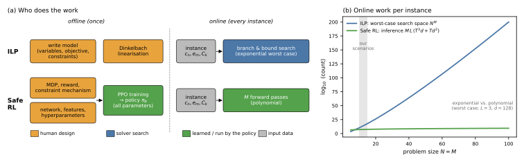

# 3.5 Computational Complexity

## 命题 1（强 NP-hard）

当冲突集为空（K = 0）时，问题退化为装箱问题（bin packing）：AR 的最大化要求用尽量少的 ECU 容纳全部服务。装箱问题是强 NP-hard 的，因此本问题强 NP-hard；除非 P = NP，不存在多项式或伪多项式时间的精确算法。

【空缺：装箱归约的严格证明（LaTeX）待补；需说明在等容量特例下 AR 最大化 ⇔ 最小化启用 ECU 数】

## ILP 规模

| 项目 | ILP |
|---|---|
| 决策变量 | MN + N 个二元变量 |
| 约束数 | M + N + MN + KN |
| 最坏情况在线求解 | 指数级（搜索空间 N^M）× Dinkelbach 迭代次数 |

## 图 3.1  ILP 与 Safe RL 的分工与在线工作量

文件：`figs/fig_ilp_vs_saferl.svg`（脚本 `src/scripts/plot_ilp_vs_saferl.py`）。
- (a) 谁在做事：橙色 = 人工设计，蓝色 = 求解器搜索，绿色 = 训练学到 / 策略执行，灰色 = 输入数据；虚线左为离线，右为在线。
- (b) 每实例在线工作量（log10，N = M）：ILP 最坏搜索空间 N^M 对比策略推理 M·L(T²d + Td²)。都是精确公式、最坏情况，不是实测时间；两线约在 N ≈ 8 相交，本文场景（N, M ∈ [10, 15]）刚过交点。实测时间见 5.7。

> 注意：此图同时涉及 4.6 的命题 2，可在 4.6 中引用。
