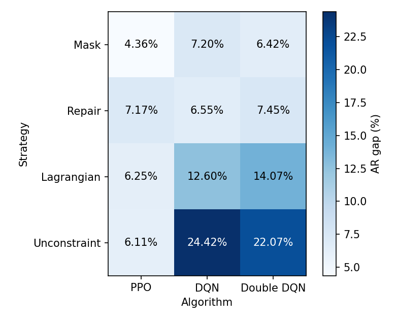

# v6.0.0-merge 2-D summary: mechanism × algorithm (gap averaged over three scenarios)

- Generated 2026-11-23 01:03:17; script `src/scripts/merge_2d_table.py`; no training, no re-evaluation.
- Test set: the fixed v6.0.4 test set, 5000 ILP-optimal instances per scenario.
- Sources: Mask PPO = v6.0.5-PPO-hyparam (n_epochs=6, `v6.0.5-PPO-hyparam-test-50k`); Lagrangian = v6.0.1-lagrangian (standard Lagrangian, `v6.0.1-lagrangian-test-50k`); Unconstraint seed 1 = v6.0.1-unconstraint (`v6.0.1-unconstraint-test-50k`); others = v6.0.0 (`v6.0.4-test-50k`).
- **gap** = 1 − mean(AR) / mean(ILP AR) over test instances completed without violation (and without EXIT for masking), AR over legal placements; per scenario averaged over seeds, each cell = plain mean of the LT, GT, EQ gaps; row / column means are plain means of the cells.

## 1. Gap averaged over LT / GT / EQ

| Mechanism \ Algorithm | PPO | DQN | Double DQN | **Row mean** |
|---|---|---|---|---|
| Mask | 4.36% | 7.20% | 6.42% | **5.99%** |
| Repair | 7.17% | 6.55% | 7.45% | **7.06%** |
| Lagrangian | 6.25% | 12.60% | 14.07% | **10.97%** |
| Unconstraint | 6.11% | 24.42% | 22.07% | **17.53%** |
| **Column mean** | **5.97%** | **12.69%** | **12.50%** | **10.39%** |

## 2. Per-scenario breakdown

| Mechanism | Algorithm | Seeds | LT | GT | EQ | Mean | Violation rate (cap or privacy) |
|---|---|---|---|---|---|---|---|
| Mask | PPO | 1,2,3 | 6.18% | 3.28% | 3.64% | 4.36% | 0.00% |
| Mask | DQN | 1,2,3 | 13.64% | 4.41% | 3.54% | 7.20% | 0.00% |
| Mask | Double DQN | 1,2,3 | 10.57% | 5.05% | 3.65% | 6.42% | 0.00% |
| Repair | PPO | 1,2,3 | 8.61% | 6.04% | 6.85% | 7.17% | 0.85% |
| Repair | DQN | 1,2,3 | 12.64% | 3.41% | 3.61% | 6.55% | 1.88% |
| Repair | Double DQN | 1,2,3 | 15.80% | 2.94% | 3.61% | 7.45% | 2.20% |
| Lagrangian | PPO | 1,2,3 | 6.33% | 6.86% | 5.55% | 6.25% | 0.64% |
| Lagrangian | DQN | 1,2,3 | 18.65% | 8.27% | 10.87% | 12.60% | 1.20% |
| Lagrangian | Double DQN | 1,2,3 | 23.57% | 5.03% | 13.61% | 14.07% | 2.11% |
| Unconstraint | PPO | 1,2,3 | 7.24% | 5.11% | 5.98% | 6.11% | 0.75% |
| Unconstraint | DQN | 1,2,3 | 27.98% | 15.45% | 29.83% | 24.42% | 30.44% |
| Unconstraint | Double DQN | 1,2,3 | 25.45% | 19.08% | 21.69% | 22.07% | 33.89% |

- Violation rate = 1 − violation-free − EXIT, averaged over scenarios and seeds; only Mask is 0, so other mechanisms' gaps are not directly equivalent to Mask's.
