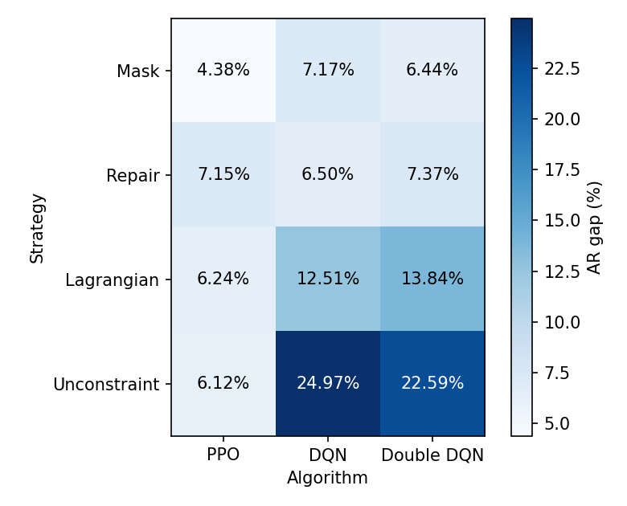

# v6.0.0-merge 二维汇总：机制 × 算法（三场景平均 gap）

- 生成时间 2026-10-29 16:01:08；脚本 `src/scripts/merge_2d_table.py`；不训练、不重新评估。
- 测试集：v6.0.4 固定测试集，每场景 5000 个 ILP 最优实例。
- 来源：Mask PPO = v6.0.5-PPO-hyparam（n_epochs=6，`v6.0.5-PPO-hyparam-test-50k`）；Lagrangian = v6.0.1-lagrangian（标准 Lagrangian，`v6.0.1-lagrangian-test-50k`）；Unconstraint seed 1 = v6.0.1-unconstraint（`v6.0.1-unconstraint-test-50k`）；其余 = v6.0.0（`v6.0.4-test-50k`）。
- **gap** = 1 − mean(AR) / mean(ILP AR)，AR 只计合法放置；每场景先对种子取均值，每格 = LT、GT、EQ 三个场景 gap 的算术平均；行/列平均为该行/列各格的算术平均。

## 1. 三场景平均 gap

| 机制 \ 算法 | PPO | DQN | Double DQN | **行平均** |
|---|---|---|---|---|
| Mask | 4.38% | 7.17% | 6.44% | **6.00%** |
| Repair | 7.15% | 6.50% | 7.37% | **7.01%** |
| Lagrangian | 6.24% | 12.51% | 13.84% | **10.86%** |
| Unconstraint | 6.12% | 24.97% | 22.59% | **17.90%** |
| **列平均** | **5.97%** | **12.79%** | **12.56%** | **10.44%** |

## 2. 各格分场景明细

| 机制 | 算法 | 种子 | LT | GT | EQ | 三场景平均 | 违约率（容量或隐私） |
|---|---|---|---|---|---|---|---|
| Mask | PPO | 1,2,3 | 6.22% | 3.28% | 3.64% | 4.38% | 0.00% |
| Mask | DQN | 1,2,3 | 13.57% | 4.41% | 3.54% | 7.17% | 0.00% |
| Mask | Double DQN | 1,2,3 | 10.62% | 5.05% | 3.65% | 6.44% | 0.00% |
| Repair | PPO | 1,2,3 | 8.56% | 6.04% | 6.85% | 7.15% | 0.85% |
| Repair | DQN | 1,2,3 | 12.49% | 3.41% | 3.61% | 6.50% | 1.88% |
| Repair | Double DQN | 1,2,3 | 15.55% | 2.94% | 3.61% | 7.37% | 2.20% |
| Lagrangian | PPO | 1,2,3 | 6.32% | 6.86% | 5.55% | 6.24% | 0.64% |
| Lagrangian | DQN | 1,2,3 | 18.37% | 8.27% | 10.87% | 12.51% | 1.20% |
| Lagrangian | Double DQN | 1,2,3 | 22.87% | 5.03% | 13.61% | 13.84% | 2.11% |
| Unconstraint | PPO | 1,2,3 | 7.27% | 5.10% | 5.99% | 6.12% | 0.75% |
| Unconstraint | DQN | 1,2,3 | 29.88% | 15.37% | 29.67% | 24.97% | 30.44% |
| Unconstraint | Double DQN | 1,2,3 | 27.42% | 19.08% | 21.27% | 22.59% | 33.89% |

- 违约率 = 1 − 无违约比例 − EXIT 比例，三场景、种子平均；只有 Mask 为 0，其余机制的 gap 不能与 Mask 直接等价比较。
